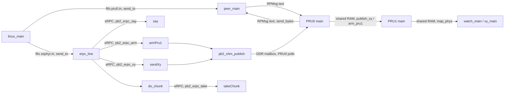
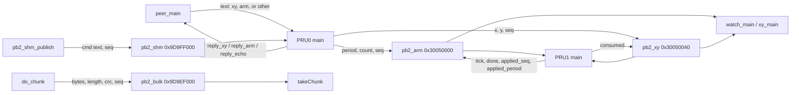
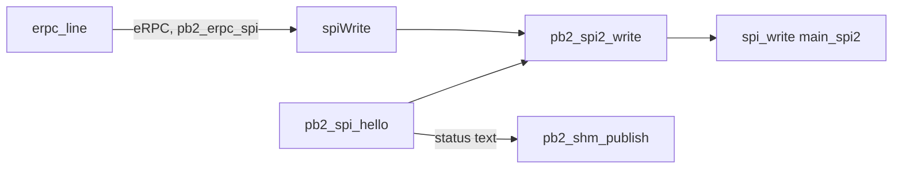

# Comms

Who calls whom, and which path the call uses. `linux_main` feeds two fifos. `peer_main` owns the PRU0 RPMsg device. `erpc_line` owns the Zephyr calls.

PRU0 announces channel `rpmsg-raw` port 30. Zephyr announces `rpmsg-raw` address 1024. `say` returns its string on that eRPC channel and does not touch the PRUs. PRU1 samples shared RAM. Nothing calls it.

What is written, where it lands, and who reads it.

`do_chunk`, `watch_main`, and `xy_main` use `map_phys` on `/dev/mem`. `takeChunk` and `pb2_shm_publish` use the same DDR addresses from the M4. `publish_xy` and `arm_pru1` use the PRU local addresses of that shared RAM.

Zephyr SPI2 stays on the M4. The boot path also leaves a status string in the mailbox PRU0 already polls.

`main` calls `pb2_spi_hello` once at boot. `spi_hello` in `pb2.c` writes SPI0 on its own.
