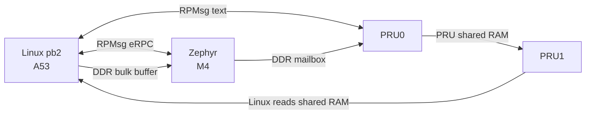

# PocketBeagle 2: Linux, Zephyr, and PRU together

A starting point for PocketBeagle 2 (TI AM6254) projects that use every core:

- **Linux** on the Cortex-A53s runs `pb2`, one program that drives the demo.
- **Zephyr** on the Cortex-M4F answers function calls from Linux (eRPC over RPMsg) and writes SPI.
- **PRU0** takes commands from Linux (RPMsg) and from Zephyr (a shared DDR mailbox).
- **PRU1** runs a cycle-counted loop and bit-bangs a UART frame on a header pin.



Each link is small and easy to copy into your own project. [How it works](#how-it-works) walks through them.

It runs on either of two card images:

- **BeagleBoard Debian.** The stock image, plus a one-time install script.
- **Yocto (Poky).** Built from `yocto/`, with the demo already installed.

## What you need

- A PocketBeagle 2 and a microSD card.
- A Linux PC with `git` and either `podman` or `docker`. Every compiler runs in a container, so you don't install any toolchains.
- Network access from the PC to GitHub, git.ti.com, and software-dl.ti.com.
- Optional: a logic analyzer, to watch SPI and the PRU1 UART on the header pins ([Probe the pins](#probe-the-pins)).

## Quick start: BeagleBoard Debian

1. **Flash the image.** Use [PocketBeagle 2 Debian 13.7 IoT, v6.18 k3](https://www.beagleboard.org/distros/pocketbeagle-2-debian-13-7-2026-10-09-iot-v6-18-x-k3), file `pocketbeagle2-debian-13.7-iot-v6.18-k3-arm64-2026-10-09-10gb.img.xz`. Boot it and make sure you can `ssh` in. Below, `USER@BOARD` is that login.

2. **Build on the PC**, from the repo root:

   ```
   ./beagle-linux/scripts/build.sh
   PB2_SSH=USER@BOARD ./beagle-linux/scripts/build.sh kmod
   ./beagle-linux/scripts/build.sh bundle
   ```

   - The first command builds `pb2`, the overlays, both PRU images, and the Zephyr M4 image. The first run downloads a lot. Later runs are quick.
   - `kmod` builds the patched PRU driver for the kernel running on your board. It copies that kernel's headers from the board once. [Why a patched driver](#why-debian-needs-a-patched-pru-driver) explains the reason.
   - `bundle` gathers everything into `out/pb2-beagle/`.

3. **Install on the board and reboot:**

   ```
   scp -r out/pb2-beagle USER@BOARD:
   ssh -t USER@BOARD 'sudo ./pb2-beagle/install-beagle.sh && sudo reboot'
   ```

   `install-beagle.sh` makes the setup survive reboots:
   - It installs `pb2`, `pb2-demo`, and the firmware.
   - It installs the patched `pru_rproc` module so the kernel loads it at boot.
   - It adds the three overlays to the default boot entry. The original is saved as `extlinux.conf.pb2-bak`.
   - It adds a udev rule so the `dialout` group can use `/dev/rpmsg*`.
   - It enables `pb2-pru.service`, which starts both PRUs at boot.

   The M4 image goes in as `/lib/firmware/pb2_m4.elf`, not under the kernel's default name `am62-mcu-m4f0_0-fw`, so the M4 stays off at boot until `pb2-demo` starts it. `pb2-demo` restarts it with the current image each time it runs. Run the script again after rebuilding. Also run it again after a kernel upgrade: the module only fits the kernel it was built for.

4. **Run the demo** on the board:

   ```
   pb2-demo --tmux
   ```

   You get a tmux session with four windows. Switch windows with Ctrl+b then 0–3. Detach with Ctrl+b then d. Come back with `pb2-demo --attach --tmux`. [What you should see](#what-you-should-see) shows the output to expect.

## Quick start: Yocto image

Build the card image on the PC, from the repo root:

```
wget -O kas-container https://raw.githubusercontent.com/siemens/kas/5.5/kas-container
chmod +x kas-container
KAS_BUILD_DIR=yocto/build ./kas-container build yocto/kas/pb2-poky.yml
```

- The machine, kernel, and layers come from TI's `kas/poky-wrynose-config.yml`, and the distro is Poky.
- The image builds `pb2`, the M4 image, both PRU images, and the overlays itself. You don't need `build.sh` for it.
- Set `KAS_CONTAINER_ENGINE` to `podman` or `docker` if you need to choose one.

Flash the timestamped file `yocto/build/deploy-ti/images/pocketbeagle2/pb2-demo-image-pocketbeagle2.rootfs-<timestamp>.wic.xz`. BeagleBoard Imager ignores the `.wic.xz` symlink next to it.

To log in:
- The serial console is `ttyS2` at 115200.
- USB brings up an NCM network gadget on `usb0` and a serial gadget.
- The login is `root` with no password, and there is no other account.

Then:

```
./pb2-demo --tmux
```

`/root` holds `pb2`, `pb2-demo`, `pb2_m4.elf`, and both PRU images. The same files are also on `PATH` and in `/lib/firmware`. As on Debian, the M4 image isn't under the default name, so the M4 stays off until `pb2-demo` starts it. The TI kernel in this image already has the PRU virtio kick, so no extra driver is needed.

## What you should see

On startup the linux window runs a short script. It pings PRU0, then sends `say`, `arm`, `chunk`, `xy 41 83`, `spi`, and `pru0 arm`. A passing run, one block per window:

```
== linux
Linux sent "ping" to PRU0
Linux asked Zephyr to say hello from linux
Linux asked Zephyr to say "hello from linux", and Zephyr replied "zephyr: hello from linux"
Linux asked Zephyr to arm PRU1 100000 30
Linux asked Zephyr to check chunk bulk-hello
Linux asked Zephyr to publish X/Y 41 83
Linux asked Zephyr to write SPI2 hello
Linux asked Zephyr to write SPI2 "hello", and Zephyr replied "zephyr: spi wrote 5 bytes"
Linux asked PRU0 to arm PRU1 250000 20
linux window ready. commands: zephyr say|arm|chunk|xy|spi ... | pru0 <text> | spi | help

== zephyr
zephyr window ready on /dev/rpmsg0 (eRPC)
Linux asked Zephyr to say "hello from linux", and Zephyr replied "zephyr: hello from linux"
Linux asked Zephyr to arm PRU1, and Zephyr published period 100000 count 30 for PRU0
Linux asked Zephyr to check the chunk, and Zephyr matched seq 1 len 10 crc c959d039
Linux asked Zephyr to publish X/Y 41 83, and Zephyr sent that pair to PRU0
Linux asked Zephyr to write SPI2 "hello", and Zephyr replied "zephyr: spi wrote 5 bytes"

== pru0
pru0 window ready on /dev/rpmsg2
sent to pru0: ping
Linux sent "ping" to PRU0, and PRU0 echoed it
Zephyr asked PRU0 to arm PRU1, and PRU0 wrote period 100000 count 30 for PRU1
Zephyr asked PRU0 to publish X/Y, and PRU0 wrote x 41 y 83 seq 1 for PRU1
sent to pru0: arm 250000 20
Linux asked PRU0 to arm PRU1, and PRU0 wrote period 250000 count 20 for PRU1

== pru1
pru1 window ready, shared ram 0x30050000
pru1 arm seq=1 period=100000 count=30
pru1 xy seq=1 x=41 y=83 consumed=1
pru1 arm seq=2 period=250000 count=20
```

`consumed=1` means PRU1 has finished sending the frame for that X/Y. The `/dev/rpmsg` numbers can differ on your board.

### Commands

Type these in the linux window:

| Command | What happens |
| --- | --- |
| `zephyr say <text>` | Zephyr replies `zephyr: <text>` (eRPC) |
| `zephyr spi [text]` | Zephyr writes `text`, or `hello`, on SPI2 (header P1) |
| `zephyr arm <period> <count>` | Zephyr asks PRU0, through the mailbox, to arm PRU1 |
| `zephyr xy <x> <y>` | Zephyr hands X/Y to PRU0, and PRU1 sends it on P1.20 |
| `zephyr chunk <text>` | Linux writes the DDR bulk buffer, and Zephyr checks its CRC |
| `pru0 xy <x> <y>` | PRU0 publishes X/Y directly, and PRU1 sends it |
| `pru0 arm <period> <count>` | PRU0 arms PRU1 directly |
| `pru0 <text>` | PRU0 echoes the text |
| `spi [device]` | Linux writes `hello` on SPI0 (header P2), `/dev/spidev0.0` by default |
| `help`, `quit` | List the commands, or leave |

`pb2-demo` without `--tmux` prints all four windows on one console instead, with each line prefixed `[Linux]`, `[M4]`, `[PRU0]`, or `[PRU1]`. Either way it restarts the M4, PRU0, and PRU1 with their firmware first. `--attach` connects to the running cores without restarting them.

## Probe the pins

All signals are 3.3 V. On a Saleae Logic, choose the 1.8 V threshold setting for 3.3 V logic.

| Signal | Header pins | What you see |
| --- | --- | --- |
| Zephyr SPI2 | P1.06 CS, P1.08 CLK, P1.10 MISO, P1.12 MOSI | `hello` at 1 MHz, mode 0, MSB first |
| Linux SPI0 | P2.31 CS, P2.29 CLK, P2.27 MISO, P2.25 MOSI | `hello` at 1 MHz, mode 0, MSB first |
| PRU1 UART | P1.20 | one SLIP frame per X/Y, 115200 8N1, idles high |

For `xy 41 83`, P1.20 carries `C0 29 00 00 00 53 00 00 00 7A C0`. [PRU1](#pru1-the-slip-frame-on-p120) explains the frame. `PINMUX.md` lists every pin the demo muxes, plus the shorted partner balls it holds off.

## How it works

### Linux to Zephyr: eRPC over RPMsg

- The M4 image opens the RPMsg channel `rpmsg-raw` at address 1024, which Linux sees as `/dev/rpmsgN`.
- `zephyr/erpc/pb2.erpc` defines the functions Linux can call on Zephyr: `say`, `spiWrite`, `armPru1`, `sendXy`, and `takeChunk`. The generated client and server code is in `zephyr/erpc/shim/`.
- Both sides run eRPC's framed transport straight over the RPMsg file descriptor (`linux-app/pb2_erpc_linux.cpp` and `zephyr/m4/src/pb2_erpc.cpp`).

The M4 console UART is not wired, so the zephyr window is the console you watch.

### Linux to Zephyr: the bulk buffer

`zephyr chunk` passes data too large for an RPC argument:
1. Linux writes the bytes into a 64 KiB DDR buffer at `0x9D9EF000` through `/dev/mem`.
2. Linux calls `takeChunk(seq, length, crc)`.
3. Zephyr checks the CRC.

The buffer sits inside the memory Linux already reserves for the M4. `zephyr/m4/boards/pocketbeagle_2_am6254_m4.overlay` shrinks the M4's DDR region so that no part of the Zephyr image lands there.

### Zephyr to PRU0: the DDR mailbox

- Zephyr writes a text command such as `xy 41 83` or `arm 100000 30` into a 4 KiB mailbox at `0x9D9FF000`, then increments a sequence number.
- PRU0 polls the sequence number.

The mailbox holds one command and has no acknowledgement. If Zephyr publishes two commands faster than PRU0 polls, PRU0 only sees the second. In practice PRU0 polls far faster than commands arrive. A real design that cares should add a ring buffer or a consumed counter. The layout is in `zephyr/include/pb2_shm.h`, which every core includes.

### Linux to PRU0: RPMsg text

- PRU0 announces RPMsg channel `rpmsg-raw` on port 30.
- Linux writes plain text: `ping`, `xy <x> <y>`, or `arm <period> <count>`.
- PRU0 replies with one sentence that names who asked and what it did.
- PRU0 learns Linux's address from the first message it receives, so Linux sends `ping` first. PRU0 can't report anything that Zephyr asks it to do until Linux has sent that first message.

### PRU0 to PRU1: PRU shared RAM

PRU0 writes two records into PRUSS shared RAM. PRU1 reads that RAM at local address `0x00010000`, and Linux reads it at `0x30050000`.

| Offset | What | Fields (little-endian `uint32`) |
| --- | --- | --- |
| `0x00` | arm block | `magic`, `seq`, `period_cycles`, `periods`, then PRU1's `tick`, `done`, `applied_seq`, `applied_period` |
| `0x40` | X/Y record | `magic` (`PB2X`), `seq`, `x`, `y`, `consumed` |

- PRU0 writes the data first and `seq` last.
- PRU1 acts when `seq` changes. When it finishes sending, it copies `seq` into `consumed`.
- `pb2 watch`, the pru1 window, prints a line whenever either `seq` changes.

### PRU1: the SLIP frame on P1.20

- PRU1 doesn't use RPMsg. It loops with a cycle-counted delay, and `arm` sets that delay.
- On a new X/Y, PRU1 sends one SLIP (RFC 1055) frame as UART 8N1 on R30 bit 5, which is header P1.20. The code is in `pru/pru1/slip_tx.asm`.
- The PRU clock is 250 MHz, and one bit is about 2170 cycles, so the rate is 115200 baud.

| Byte | Value |
| --- | --- |
| 0 | `0xC0` (END) |
| 1–4 | X, least-significant byte first |
| 5–8 | Y, least-significant byte first |
| 9 | XOR of bytes 1–8 |
| 10 | `0xC0` (END) |

If a payload byte is `0xC0`, it goes out as `0xDB 0xDC`. If it is `0xDB`, it goes out as `0xDB 0xDD`.

### Why Debian needs a patched PRU driver

RPMsg is two ring buffers in shared memory, plus a doorbell in each direction.
- The Linux-to-PRU doorbell is the remoteproc `.kick` operation. It raises a PRUSS system event that PRU0 sees as an interrupt.
- The PRU-to-Linux doorbell is a "vring" interrupt.

The `pru_rproc` driver in the BeagleBoard 6.18 kernel has neither. Linux refuses to start RPMsg firmware on that driver, with `.kick method not defined`.

`beagle-linux/kernel/pru_rproc/` is that driver with TI's kick and vring IRQ handler added back. PRU1 uses no RPMsg, so only PRU0 needs it. The TI 6.12 kernel in the Yocto image already has these pieces.

If you don't need RPMsg on a PRU, a shared-RAM mailbox like PRU1's works with the stock driver.

### Pin muxing

- **Linux overlays.** The header pins for Linux SPI0, PRU1's P1.20, and the leftover GPIOs are set by Linux overlays in `beagle-linux/overlays/`. They are written with `AM62X_IOPAD()` from BeagleBoard-DeviceTrees `ti/k3-pinctrl.h`. That header isn't copied into this repo; `build.sh` fetches a pinned commit.
- **SPI2 in the Zephyr image.** The SPI2 pins on header P1 are muxed by the Zephyr devicetree overlay, inside `pb2_m4.elf`. The M4 can write those pad registers only because Linux has already unlocked them.

The full pin list is `PINMUX.md`.

## Build details

`./beagle-linux/scripts/build.sh [target]` builds the container images under `containers/`, then compiles inside them as your own user. It uses podman if installed, otherwise docker; set `PB2_CONTAINER_ENGINE` to pick one.

| Target | Output | Notes |
| --- | --- | --- |
| `linux` | `linux-app/pb2`, `beagle-linux/overlays/*.dtbo` | Debian 13 aarch64 cross compiler. Fetches EmbeddedRPC 1.14.0 and BeagleBoard-DeviceTrees. |
| `pru` | `pru/build/am62x-pru0-fw`, `am62x-pru1-fw` | TI PRU compiler 2.3.3 and the PRU Software Support Package. |
| `zephyr` | `build/zephyr/pb2_m4.elf` | Zephyr SDK 1.0.1. Zephyr is pinned in `zephyr/west.yml` and checked out at `zephyr/upstream`. |
| `kmod` | `beagle-linux/kernel/pru_rproc/pru_rproc.ko` | Needs `PB2_SSH`. Reads the kernel version from the board, or from `PB2_KREL`. |
| `bundle` | `out/pb2-beagle/` | Everything `install-beagle.sh` needs. Run it after the other targets. |
| `all` (default) | `linux`, `pru`, and `zephyr` | |

### Common problems

- **"Permission denied" deleting `build/`, `.west/`, or `modules/`.** These files came from an older checkout, whose containers wrote them as another uid. Clear them once:
  - podman: `podman unshare rm -rf build .west modules bootloader tools zephyr/upstream`
  - docker: `sudo rm -rf` the same paths
- **Zephyr build fails with `Not a file: .../pristine.cmake`.** `build/` is from before a directory move. Delete `build/` and build again.
- **Don't run `west init -l .` from the repo root.** That puts the workspace in the parent directory. The script runs `west init -l zephyr` instead.
- **`dmesg` shows `Direct firmware load for am62-mcu-m4f0_0-fw failed with error -2` at boot.** That is expected. The kernel tries to boot the M4 under its default name, finds nothing, and leaves it off. `pb2-demo` starts it with `pb2_m4.elf`.
- **`kmod` fails to copy `/usr/src/linux-headers-...`.** The BeagleBoard image ships the headers for its kernel. If yours doesn't have them, run `sudo apt install linux-headers-$(uname -r)` on the board.
- **The PRU0 window never appears, and `dmesg` says `.kick method not defined`.** The stock `pru_rproc` is loaded. This is usually after a kernel upgrade. Rebuild with `build.sh kmod`, run `bundle`, and install again.

## Repository

`LAYOUT.md` is the directory map. `PINMUX.md` is the pin list.

## License

MIT; see `LICENSE`. `beagle-linux/kernel/pru_rproc/` is GPL-2.0-only because it is derived from the Linux driver.
